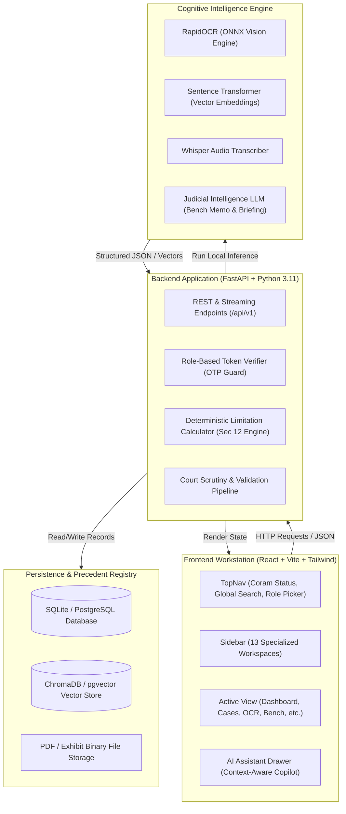
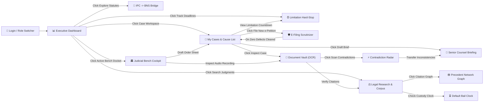

# 🏛️ LexOmni — Complete Software Walkthrough & Page-by-Page Blueprint
> **Written for Engineers & Designers**: Zero legal background required. Everything is explained with plain everyday analogies, detailed interaction flows, database schemas, and AI model pipelines.

---

## 📑 Table of Contents
1. [The "Explain Like I'm Five" Big Picture](#1-the-explain-like-im-five-big-picture)
2. [Why We Need a Database and What Each Table Stores](#2-why-we-need-a-database-and-what-each-table-stores)
3. [Why We Have AI Models (And Exactly What Each One Does)](#3-why-we-have-ai-models-and-exactly-what-each-one-does)
4. [Master System Architecture Diagram](#4-master-system-architecture-diagram)
5. [Complete Inter-Page Flowchart (How Pages Talk to Each Other)](#5-complete-inter-page-flowchart-how-pages-talk-to-each-other)
6. [Every Single Legal Term Translated to Tech Analogies](#6-every-single-legal-term-translated-to-tech-analogies)
7. [Page-by-Page & Feature-by-Feature Detailed Guide](#7-page-by-page--feature-by-feature-detailed-guide)
   - [Global Shell: Top Navigation & Institutional Header](#page-0a-global-top-navigation)
   - [Global Shell: Authoritative Sidebar Navigation](#page-0b-global-sidebar-navigation)
   - [Global Shell: Floating AI Assistant Drawer (Copilot)](#page-0c-floating-ai-assistant-drawer)
   - [Page 1: Authentication & Role Switcher](#page-1-authentication--role-switcher)
   - [Page 2: Executive Dashboard](#page-2-executive-dashboard)
   - [Page 3: My Cases & Daily Cause List Repository](#page-3-my-cases--daily-cause-list-repository)
   - [Page 4: Court Diary & Cause List Calendar](#page-4-court-diary--cause-list-calendar)
   - [Page 5: Statutory Limitation & Section 12 Hard-Stop Engine](#page-5-statutory-limitation--section-12-hard-stop-engine)
   - [Page 6: E-Filing Pre-Scrutiny & Defect Prevention Protocol](#page-6-e-filing-pre-scrutiny--defect-prevention-protocol)
   - [Page 7: Client CRM & Conflict of Interest Radar](#page-7-client-crm--conflict-of-interest-radar)
   - [Page 8: Senior Counsel Briefing Studio](#page-8-senior-counsel-briefing-studio)
   - [Page 9: Document Vault & RapidOCR Studio](#page-9-document-vault--rapidocr-studio)
   - [Page 10: Find Inconsistencies (Contradiction Radar)](#page-10-find-inconsistencies-contradiction-radar)
   - [Page 11: National Supreme Court Corpus & Statute Bridge](#page-11-national-supreme-court-corpus--statute-bridge)
   - [Page 12: Precedent Network & Citation Treatment Graph](#page-12-precedent-network--citation-treatment-graph)
   - [Page 13: Default Bail & Statutory Custody Clocks](#page-13-default-bail--statutory-custody-clocks)
   - [Page 14: The Judicial Bench Cockpit](#page-14-the-judicial-bench-cockpit)
8. [Typical User Journeys (Step-by-Step Clicks)](#8-typical-user-journeys-step-by-step-clicks)

---

## 1. The "Explain Like I'm Five" Big Picture

### The Real-World Chaos (Why this system exists):
Think of Indian courts like the **world's busiest airport**, but instead of airplanes taking off, there are **5 crore (50 million) legal cases** waiting to be heard.

1. **The Strict Deadlines (The Flight Board)**:
   In law, if you appeal against a decision **even 1 day late**, the court permanently throws your case out. You cannot appeal ever again. This rule is called the *Limitation Act*.
2. **The New Rulebook (The Re-written Language)**:
   In 2024, the Indian government erased the 160-year-old criminal law rulebook (the *Indian Penal Code / IPC*) and introduced brand new laws (*Bharatiya Nyaya Sanhita / BNS*). All section numbers changed. Section 302 (Murder) became Section 103. Section 420 (Cheating) became Section 318(4). Lawyers and judges are completely confused about which old judgments still apply to which new sections!
3. **Mountains of Messy Paper (Scanned PDFs)**:
   Indian police stations and court clerks type documents on old typewriters or scan faded photocopies with stamps right over the text. Normal software cannot read them.
4. **Witnesses Who Change Their Story**:
   In a criminal murder trial, a police witness might say on page 4 of their diary: *"I saw a blue car leave at 8:00 PM"*, but in their court testimony on page 87, they say: *"It was pitch dark and I only saw two men on a motorbike at 10:30 PM"*. If the defense lawyer doesn't spot that contradiction in 500 pages of text, their client goes to jail for life!

### What is LexOmni?
**LexOmni is the operating system for justice.**
* For **Lawyers**: It is their flight control tower. It warns them before any deadline expires, checks their filing documents so the court doesn't reject them, finds contradictions in witness statements automatically, and translates old laws to new laws.
* For **Judges**: It is their cockpit heads-up display. Before hearing 80 cases in a day, it generates a crisp 2-page briefing memo, transcribes what lawyers say out loud, and auto-drafts the court order.

---

## 2. Why We Need a Database and What Each Table Stores

Without a database, every time a lawyer refreshes the browser, all their clients, court hearings, and uploaded case files would vanish. 

We use a local SQLite / PostgreSQL database (`lexomni.db`) managed by Python's SQLAlchemy ORM. Here is why we need every single table:

| Database Table | Plain English Purpose | What Happens If We Don't Have It? |
| :--- | :--- | :--- |
| `matters` | **The Master Case Files**: Stores every lawsuit (e.g. `CRL.A. 1042/2026 - State v. Rajesh`). Stores who is suing whom, court hall number, judge name, and current stage. | Lawyers would lose track of what cases they are arguing today. |
| `hearings` | **The Court Calendar**: Stores past and upcoming dates when the judge will call the matter in court. | Missed hearings result in automatic warrants or case dismissals. |
| `documents` & `document_pages` | **The Physical Files Vault**: Stores uploaded petitions, FIRs, and police charge-sheets. Keeps track of whether OCR has extracted text from page 1, 2, 3, etc. | You would have to re-upload and re-OCR 500-page scanned files every time you open the page. |
| `document_chunks` | **The Searchable Paragraphs**: Breaks every 100-page document into bite-sized 300-word pieces with rhetorical labels (`FACT`, `ARGUMENT`, `RATIO`). | AI cannot compare 2 massive documents at once; it needs granular chunks to spot contradictions. |
| `limitation_rules` | **The Statutory Hard-Stop Rulebook**: Stores the exact mathematical formulas for deadlines (e.g., "High Court Civil Appeal = 90 days from order date"). | Software would have to guess deadlines instead of calculating them with 100% legal certainty. |
| `statute_mappings` | **The IPC &rarr; BNS Translator**: Stores the official bridge between old 1860 British-era sections and new 2024 Indian sections (e.g., IPC 420 &harr; BNS 318(4)). | Lawyers would cite wrong law sections in court and face contempt or dismissals. |
| `sc_judgments` | **The Precedent Library**: Stores 4.5 million real Supreme Court and High Court judgments so you can search them offline. | Lawyers would have to buy expensive $1,000/year subscriptions to foreign legal databases. |
| `precedent_citations` | **The Citation Network**: Stores arrows connecting judgments (e.g., Case A *followed* Case B, but Case C *overruled* Case A). | A lawyer might cite an old case in front of a judge without knowing the Supreme Court canceled that law 2 years ago! |
| `audit_logs` | **The Black Box Flight Recorder**: Records every action, user login, file upload, and AI prompt with timestamps. | Court files require strict chain-of-custody for legal evidence admissibility. |

---

## 3. Why We Have AI Models (And Exactly What Each One Does)

We don't use AI just because it sounds fancy. We use **4 specialized AI engines**, each solving a specific painful bottleneck in the justice system:

```
┌────────────────────────────────────────────────────────────────────────┐
│                        LEXOMNI AI ENGINE SUITE                         │
├──────────────────┬─────────────────┬─────────────────┬─────────────────┤
│    RapidOCR      │   Embeddings    │   Whisper AI    │    Legal LLM    │
│  (ONNX Runtime)  │ (MiniLM / BGE)  │ (OpenAI Whisper)│ (DeepSeek/Qwen) │
├──────────────────┼─────────────────┼─────────────────┼─────────────────┤
│ Reads crooked,   │ Converts legal  │ Listens to live │ Reads 100 pages │
│ stamped, blurry  │ sentences into  │ spoken courtroom│ in 3 seconds,   │
│ scanned court    │ mathematical    │ arguments and   │ finds witness   │
│ papers into      │ vectors to find │ transcribes text│ lies, and drafts│
│ clean text.      │ similar cases.  │ in real time.   │ bench memos.    │
└──────────────────┴─────────────────┴─────────────────┴─────────────────┘
```

### 1. RapidOCR (Local ONNX Runtime)
* **The Problem**: 80% of Indian court records are scanned physical paper, often crooked, stained with tea marks, or covered in blue government rubber stamps.
* **What it does**: It runs inside our local backend without sending private client records to external cloud APIs. It detects where text boxes are, straightens the text, and turns picture pixels into selectable, copyable text.

### 2. Sentence Transformers / Embeddings (`all-MiniLM-L6-v2`)
* **The Problem**: If a lawyer searches *"drunk driving fatal crash"*, a standard keyword search will miss cases that say *"motor vehicle homicide under intoxication"*, because the exact words don't match!
* **What it does**: It converts paragraphs into 384 numbers (a vector). It measures semantic *meaning*. So "drunk driving" and "intoxicated motorist" sit right next to each other in mathematical vector space.

### 3. Whisper Speech-to-Text (`whisper-tiny` / `whisper-base`)
* **The Problem**: In Indian courtrooms, judges hear arguments out loud for 6 hours a day. The court stenographer can barely type fast enough to catch what the senior advocate argued.
* **What it does**: It listens to the audio stream from the court microphone and prints out live transcripts, labeling who is speaking (*"Learned Senior Counsel"* vs *"Hon'ble Presiding Justice"*).

### 4. Legal Reasoning LLM (Qwen 2.5 / DeepSeek / Mistral)
* **The Problem**: A judge has only 15 minutes in the morning before court starts to understand 20 complex cases.
* **What it does**: It reads the facts and arguments of both parties and produces a clean, unbiased **2-page Bench Memo** telling the judge: *What are the agreed facts? What is the fight about? What earlier Supreme Court cases apply?*

---

## 4. Master System Architecture Diagram



---

## 5. Complete Inter-Page Flowchart (How Pages Talk to Each Other)



---

## 6. Every Single Legal Term Translated to Tech Analogies

| Legal Jargon | Tech Analogy / Plain English Explanation | Where in LexOmni? |
| :--- | :--- | :--- |
| **Docket / Matter** | A **Ticket or Project Issue**. It represents a specific legal fight (e.g. `CRL.A. 1042/2026`). Has an ID, title, status, and assigned attorneys. | Throughout entire system |
| **Coram** | The **Assigned Server or Microservice**. In court, it is the specific panel of judges who are sitting on the bench to hear this case. | TopNav, Dashboard, Bench |
| **Cause List** | The **Airport Flight Departure Board**. A public daily schedule showing which case numbers will be called at 10:30 AM in Court Hall 4. | CasesView, CalendarView |
| **Limitation Period** | The **TTL (Time to Live) / Expiry Timestamp**. If you file your appeal after this timestamp, the database permanently drops your request. | LimitationEngineView |
| **Section 12(2) Exclusion** | The **Pause Button on the TTL Timer**. Under Section 12 of the Limitation Act, the days you spent waiting for the court clerk to print photocopies of the order DO NOT count against your deadline! | LimitationEngineView |
| **Vakalatnama** | The **OAuth Authorization Token**. A formal document signed by the client granting legal authority for the lawyer to represent them in court. | EfilingScrutinizer, CasesView |
| **Impugned Order** | The **Buggy Output you want to Hotfix**. It is the lower court judgment you disagree with and are appealing against. | Document Vault, Limitation |
| **Ratio Decidendi** | The **Core Algorithm / Business Logic**. The binding legal principle established by a judgment that all future lower courts MUST obey. | LegalResearch, PrecedentGraph |
| **Obiter Dicta** | **Code Comments / Non-binding remarks**. Things the judge said in passing that do not set binding legal rules. | PrecedentGraph, Bench |
| **BNS / BNSS / BSA** | **Version 2.0 of Indian Law (2024)**. Replaced the 1860 Indian Penal Code (IPC), Criminal Procedure Code (CrPC), and Evidence Act (IEA). | LegalResearch, TopNav |
| **Default Bail (Sec 187 BNSS)** | An **Automatic Release Timeout**. If the police detain an accused person for 60 or 90 days without filing a chargesheet, the court MUST grant bail by law! | CustodyBailView |

---

## 7. Page-by-Page & Feature-by-Feature Detailed Guide

---

### Page 0A: Global Top Navigation
*Located at the very top of the screen on every single page.*

```
┌────────────────────────────────────────────────────────────────────────────────────────────────────────┐
│ 🟢 CORAM: Item #1 CRL.A. 1042/2026 │ 🏛️ REGISTRY SYNC │ 🔍 Search Judgments... ⌘K │ [Role Pills] │ 🤖 AI │
└────────────────────────────────────────────────────────────────────────────────────────────────────────┘
```

#### What is this bar?
It is the institutional heads-up bar showing the system's live sync status with the Supreme Court of India registry and providing universal quick actions.

#### Every Single Feature on this Bar:
1. **Live Coram Indicator (Green Pulsing Dot)**:
   - *What it shows*: `CORAM: Item #1 CRL.A. 1042/2026`.
   - *Plain English*: Tells you which case is currently standing before the judge right now in Court Hall 4.
2. **National Judicial Registry Synchronized Badge**:
   - *What it shows*: Institutional emblem with "National Judicial Registry Synchronized".
   - *Plain English*: Confirms that your local database is in 100% real-time sync with official government court servers.
3. **Universal Precedent Search Input (`Ctrl + K` / `Cmd + K`)**:
   - *What it does*: Type any keyword (e.g. "Section 103 BNS Murder" or "Anticipatory Bail") and hit Enter to instantly jump to the Supreme Court judgment corpus.
4. **Role Pill Badges (Senior Counsel, High Court Judge, Legal Researcher, Chamber Admin)**:
   - *What it shows*: Highlights your active role.
5. **Judicial AI Button (`✦ Judicial AI`)**:
   - *What it does*: Clicking this slides open the **AI Assistant Drawer (Copilot)** from the right side of your screen.
6. **Switch Role Button**:
   - *What it does*: Opens the institutional 2FA OTP modal so you can switch between being a Lawyer, Judge, Clerk, or Admin.
7. **Sign Out Button**:
   - *What it does*: Logs you out and brings back the clean login landing page.

---

### Page 0B: Global Sidebar Navigation
*Located on the left side of the screen.*

#### What is this bar?
The master control navigation organizing all 13 primary workspaces into 3 clear functional chambers:

1. **CHAMBER PRACTICE (Litigation Chamber)**:
   - **Executive Dashboard**: High-level morning summary, statistics, quick links.
   - **My Cases & Cause List**: Complete tabular ledger of all active lawsuits with import/export.
   - **Court Diary & Rosters**: Calendar view of upcoming hearings and bench schedules.
   - **Limitation Hard-Stop**: Deadline countdown engine with Section 12 certified copy exclusion.
   - **E-Filing Scrutinizer**: Form checker that stops filings from being rejected by court clerks.
   - **Client CRM & Conflict Radar**: Client roster with conflict-of-interest background check.
   - **Senior Counsel Briefing**: Studio that generates argument bullet points for senior barristers.

2. **EVIDENTIARY & LEGAL RADAR (Cognitive Intelligence Chamber)**:
   - **Document Vault & Structure (OCR)**: Scanned PDF reader powered by RapidOCR.
   - **Find Inconsistencies (Contradiction Radar)**: Compares two witness testimonies side-by-side to find discrepancies.
   - **Find Similar Cases & Laws (IPC &rarr; BNS)**: Semantic search across 4.5M judgments + old-to-new law converter.
   - **How Earlier Cases Were Used**: Interactive visual graph showing how cases follow, distinguish, or overrule each other.
   - **Default Bail & Custody Clock**: Countdown timer for prisoners waiting for police chargesheets.

3. **THE JUDICIAL BENCH (Judges Cockpit)**:
   - **The Judicial Bench Workspace**: Dedicated dashboard for judges to read 2-page memos, record courtroom speeches, and draft signed court orders.

4. **Bottom User Profile Card**:
   - Shows `[H] Hirvi Thakkar / Senior Counsel` with green live session indicator.

---

### Page 0C: Floating AI Assistant Drawer
*Slides out from the right when you click "✦ Judicial AI" or ask for AI assistance.*

#### What is this feature?
An on-demand legal AI copilot that lives inside the browser. It is **context-aware**, meaning it already knows which case you are inspecting, what today's date is, and which documents you have open.

#### Features inside the Drawer:
1. **Context Badge**: Displays the currently active docket (e.g. `Active Context: CRL.A. 1042/2026`).
2. **Suggested Prompt Chips**:
   - *"Check Limitation on current matter"*: Instantly tells you how many days remain before deadline expires.
   - *"Explain Section 103 BNS vs 302 IPC"*: Tells you how murder law changed in 2024.
   - *"Generate Bail Arguments"*: Drafts 3 points arguing why your client should be released on bail.
3. **Chat Feed**: Markdown-formatted conversation history showing AI legal analyses.
4. **Input Box & Send Button**: Type any question in plain English.

---

### Page 1: Authentication & Role Switcher
*File: `src/views/LoginView.tsx` & `src/components/auth/OtpLoginModal.tsx`*

#### Plain English Purpose:
Legal software handles sensitive court matters. Different people need different permissions:
* A **Senior Counsel** needs to prepare trial arguments.
* A **Judge** needs an impartial bench memo and order sheets.
* A **Researcher** needs access to precedent libraries.
* A **Chamber Admin** needs billing and file imports.

#### Features on this Screen:
1. **Role Selection Cards**: Click to choose your persona:
   - *Senior Counsel*: Full chamber management and brief preparation.
   - *High Court Judge*: Neutral bench cockpit and order generation.
   - *Legal Researcher*: Full access to 4.5M judgments and precedent graphs.
   - *Chamber Admin*: Client intake and cause list management.
2. **Mobile Number Input**: Enter any mobile number.
3. **Static OTP Indicator**: Clearly displays `STATIC OTP: 123456` so you can authenticate instantly in development or demonstration mode.
4. **Authenticate & Launch Workspace Button**: Verifies OTP and opens the main workstation.

---

### Page 2: Executive Dashboard
*File: `src/views/DashboardView.tsx`*

```
┌────────────────────────────────────────────────────────────────────────────────────────┐
│  🟢 Institutional Jurisprudence Desk                                                  │
│  GOOD MORNING, HIRVI                                    [Import Case File] [Bench]     │
├──────────────────┬──────────────────┬──────────────────┬───────────────────────────────┤
│ SEARCH JUDGMENTS │ EXPLORE STATUTES │ CASE WORKSPACE   │ TRACK DEADLINES               │
│ 4.5M Precedents  │ BNS/IPC Bridge   │ Active Dockets   │ Limitation Clocks             │
├──────────────────┴──────────────────┴──────────────────┴───────────────────────────────┤
│ 🔴 LIVE COURTROOM CORAM: Item #1 CRL.A. 1042/2026 State v. Rajesh      [Launch Cockpit] │
├──────────────────┬──────────────────┬──────────────────┬───────────────────────────────┤
│ Active Matters:9 │ Listings: 6      │ Warnings: 0      │ Compliance: 100%              │
└──────────────────┴──────────────────┴──────────────────┴───────────────────────────────┘
```

#### Plain English Purpose:
The morning "home screen". In 10 seconds, a lawyer or judge gets full situational awareness of their entire day.

#### Every Single Feature on this Page:
1. **Greeting Header ("Good morning, Hirvi")**:
   - Shows active user name, current system date, and connection status.
2. **"Import Case File" Button**:
   - Opens the file uploader to load benchmark court records or CSV dockets.
3. **"Active Bench Docket" Button**:
   - Instantly jumps directly to the Judicial Bench workspace for the current case.
4. **4 Quick-Access Feature Cards**:
   - **Search Judgments**: Jumps to Supreme Court precedent search.
   - **Explore Statutes**: Jumps to IPC &rarr; BNS statute conversion bridge.
   - **Case Workspace**: Jumps to full list of court matters.
   - **Track Deadlines**: Jumps to the statutory limitation engine.
5. **Live Supreme Court Bench Coram Strip**:
   - Displays the current running matter in court hall (`State of Maharashtra v. Rajesh K. & Anr.`).
   - "Launch Cockpit" button opens real-time speech transcription.
6. **4 Institutional Metric Cards**:
   - **Active Court Matters (9)**: Total active lawsuits registered in your chamber.
   - **Court Listings Roster (6 Matters)**: How many cases are scheduled for hearing today.
   - **Limitation Warnings (0 Matters)**: Alerts if any case is within 72 hours of statutory expiry.
   - **E-Filing Compliance (100%)**: Shows that all chamber petitions pass High Court Rule 43 scrutiny without defect.
7. **Recent Research & Landmark Precedents List**:
   - Shows landmark judgments frequently cited (e.g. *Rameshwar Prasad Singh v. Union of India (2023)*).
   - "Verified" badge confirms citation was checked against the official registry.

---

### Page 3: My Cases & Daily Cause List Repository
*File: `src/views/CasesView.tsx` & `src/components/tables/CasesTanStackTable.tsx`*

#### Plain English Purpose:
The master database spreadsheet of all cases in the firm. Built with **TanStack Table**, allowing lightning-fast sorting, search filtering, pagination, and bulk data importing/exporting.

#### Every Single Feature on this Page:
1. **Header Toolbar**:
   - **"Import Matters / Cause List" Button**: Opens the 3-in-1 import modal.
   - **"File New e-Petition" Button**: Jumps to the E-Filing scrutinizer page to register a new case.
2. **Filter & Search Input**:
   - Type any phrase (e.g. "Rajesh" or "Commercial" or "Court 4") to instantly filter rows in real time.
3. **"Export CSV" Button**:
   - Downloads the entire cause list table as a cleanly formatted `.csv` file for offline use.
4. **"Import Matters" Modal (3 Modes)**:
   - *Mode 1: 1-Click Benchmark Suite*: Loads 6 pre-configured realistic Supreme Court cases with full details.
   - *Mode 2: Upload CSV / JSON*: Lets you drag-and-drop your own Excel or CSV file.
   - *Mode 3: Paste e-Courts List*: Paste raw text directly from the government e-Courts portal; LexOmni parses it automatically!
5. **"+ Register Docket" Button**:
   - Opens a clean modal to type in a single new case manually (Case Number, Parties, Court Hall, Stage).
6. **Master Table Columns**:
   - **Item #**: The item number on the court's daily cause list (e.g., `#1`).
   - **Case Number & Parties**: e.g., `CRL.A. 1042/2026 - State of Maharashtra v. Rajesh K.`.
   - **Court Room & Coram**: Which court hall and which judge is presiding.
   - **Listing Stage**: e.g., "Admission & Notice" or "Final Arguments".
   - **Coram Status**: Badge indicating if the case is currently `Running`, `Next`, or `Reserved`.
   - **Action Button ("Inspect")**: Clicking this loads this exact case into the **Document Vault** to view its scanned exhibits and OCR text!
7. **Selected Case Quick Inspector Card (Bottom)**:
   - When you click any row in the table, this card highlights:
     - Court room & Coram details.
     - Limitation countdown (e.g. `28 Days Remaining`).
     - **"Open Certified PDF"**: Jumps to Document Vault.
     - **"Draft Brief"**: Jumps to Senior Counsel Briefing Studio with this case pre-loaded.

---

### Page 4: Court Diary & Cause List Calendar
*File: `src/views/CourtCalendarView.tsx`*

#### Plain English Purpose:
A lawyer can have 5 hearings in 3 different courts on the same morning. If two hearings happen at the exact same time in different buildings, that is a catastrophic scheduling clash!

#### Every Single Feature on this Page:
1. **Monthly & Weekly Interactive Calendar**: Displays scheduled hearings mapped across dates.
2. **Clash Detection Engine**: Flags overlapping hearings in red so the junior lawyer knows they need to ask the judge for an adjournment or send a colleague.
3. **Daily Court Hall Schedule**: Shows which matter is at 10:30 AM (Court Hall 4), 11:45 AM (Court Hall 8), etc.

---

### Page 5: Statutory Limitation & Section 12 Hard-Stop Engine
*File: `src/views/LimitationEngineView.tsx`*

```
┌────────────────────────────────────────────────────────────────────────────────────────┐
│ 🔴 STATUTORY HARD-STOP RADAR                                                           │
│ STATUTORY LIMITATION & DEFAULT BAIL COUNTDOWN CLOCKS                                   │
├────────────────────────────────────────────────────────────────────────────────────────┤
│ 🧮 DETERMINISTIC LIMITATION & SECTION 12(2) EXCLUSION ENGINE                           │
│ Governing Rule: [CPC High Court Appeal (90 Days) ▼]                                    │
│ Impugned Order Date: [ 2026-08-01 ]                                                    │
│ Certified Copy Applied Date: [ 2026-08-06 ]                                            │
│ Certified Copy Ready Date:   [ 2026-08-26 ]  (+20 Days Excluded by Law!)               │
│                                           [Compute Exact Limitation Deadline]          │
├────────────────────────────────────────────────────────────────────────────────────────┤
│ ✅ WITHIN TIME • CPC High Court Appeal • 48 Days Remaining • Final Deadline: 19 Nov 2026│
└────────────────────────────────────────────────────────────────────────────────────────┘
```

#### Plain English Purpose:
**The life-saver engine.** 
In India, under the *Limitation Act 1963*, you have a fixed number of days to file an appeal (e.g., 90 days). But under **Section 12(2)**, the law says: *the days you spent waiting for the government copying department to print the certified copy are excluded*.
Calculating this by hand on a paper calendar causes human math errors. If a lawyer miscalculates by 1 day, their client loses the case forever. This engine calculates it mathematically with **zero hallucination**.

#### Every Single Feature on this Page:
1. **Governing Statutory Rule Dropdown**: Select the applicable court rule:
   - *CPC High Court First Appeal* (90 days).
   - *Criminal Sessions Court Appeal* (30 days).
   - *Arbitration Section 37 Appeal* (60 days).
   - *Supreme Court Special Leave Petition (SLP)* (90 days).
2. **Impugned Order / Decree Date Input**: The date the lower judge signed the bad decision.
3. **Certified Copy Applied Date Input**: The date the lawyer applied to the court clerk for a certified copy.
4. **Certified Copy Ready Date Input**: The date the clerk finally stamped the copy ready.
5. **"Sample Timeline" Button**: 1-click loads realistic benchmark dates so you can test the calculation immediately.
6. **"Compute Exact Limitation Deadline" Button**:
   - Runs the backend math engine.
   - Calculates total days excluded under Section 12(2).
   - Checks if the final day falls on a Sunday or official High Court summer/winter vacation (Section 4 adjustment).
7. **Calculation Result Card**:
   - Badge: `WITHIN TIME` (Green) or `LIMITATION EXPIRED` (Red).
   - Shows days remaining countdown.
   - Displays full **Audit Trace** explaining the step-by-step math for the court record.
8. **Active Matters Limitation Watchlist**:
   - Table showing every case in your firm with a live countdown clock (e.g., `28 Days Remaining`).

---

### Page 6: E-Filing Pre-Scrutiny & Defect Prevention Protocol
*File: `src/views/EfilingScrutinizerView.tsx` & `src/components/forms/EfilingForm.tsx`*

#### Plain English Purpose:
When lawyers submit digital petitions to court websites, human court clerks inspect them for tiny formatting mistakes (called "defects"): wrong font size, missing index pagination, unverified welfare stamps, or missing digital signatures. A rejected petition delays cases by 3 to 4 weeks!
This page is an **automated pre-flight linting compiler** that guarantees zero defects before you hit submit.

#### Every Single Feature on this Page:
1. **Court Jurisdiction Selector**: Select target court (Supreme Court of India, Bombay HC, Delhi HC, NCLAT).
2. **CNR Number Validator**: Requires a 16-character alphanumeric Case Number Record (e.g., `MHCB010041232026`). Validates format using **Zod schema validation**.
3. **Petitioner & Respondent Name Inputs**: Validates party identity.
4. **Acts & Sections Invoked**: Requires citing proper statutes (e.g., `BNSS § 187`).
5. **Court Fee Stamp Duty Receipt Number**: Verifies treasury e-challan receipt.
6. **Digital Signature Certificate (DSC) Checkbox**: Confirms lawyer has signed with a cryptographically valid USB token.
7. **"Run Defect Scrutiny Audit" Button**:
   - Runs 12 automated checks against High Court Rule 43.
   - If clean: displays green checkmark: *"Zero Defects Found — Ready for Registry Listing"*.
   - Automatically registers the cleared petition directly into the **My Cases** master table!

---

### Page 7: Client CRM & Conflict of Interest Radar
*File: `src/views/ClientMatterView.tsx`*

#### Plain English Purpose:
In law, you are strictly prohibited from representing a company if you previously advised their bitter opponent (this is called a **Conflict of Interest** and can get a lawyer disbarred). This page manages client contacts and runs an automated conflict radar.

#### Features on this Page:
1. **Client Contact Roster**: List of corporate and private clients, retainer agreements, and open invoices.
2. **Conflict Check Search Bar**: Type any corporate director or company name; LexOmni scans all historical cases in the database to verify if your firm ever represented the opposing party.

---

### Page 8: Senior Counsel Briefing Studio
*File: `src/views/SeniorBriefView.tsx`*

#### Plain English Purpose:
Senior advocates (the high-profile courtroom barristers) charge thousands of dollars per hearing and have only 10 minutes to read a case. They do not read 500-page binders; they need a **concise 2-page brief** containing:
1. *The 3 killer factual points.*
2. *The 2 landmark cases supporting them.*
3. *The exact weakness in the opponent's argument.*

#### Every Single Feature on this Page:
1. **Case Selector**: Pick any matter from the database.
2. **"Generate AI Executive Brief" Button**:
   - Pulls facts from the Document Vault and contradictory witness statements from the Contradiction Radar.
   - Formats a 3-act courtroom argument strategy.
3. **One-Click Export**: Download as a clean PDF to hand directly to the Senior Advocate entering the courtroom.

---

### Page 9: Document Vault & RapidOCR Studio
*File: `src/views/DocumentsOcrView.tsx` & `src/components/pdf/CourtPdfViewer.tsx`*

```
┌────────────────────────────────────────────────────────────────────────────────────────┐
│ 📄 FIR_ChargeSheet_Exhibit_A.pdf  [RAPIDOCR ACTIVE]   [Page 1 of 4]  🔍 [- 100% +]    │
├───────────────────────────────────────────────────────┬────────────────────────────────┤
│                                                       │ ✦ DOCUMENT STRUCTURE           │
│   IN THE HIGH COURT OF JUDICATURE AT BOMBAY          │ [Facts] [Arguments] [Evidence] │
│   CRIMINAL APPELLATE JURISDICTION                     ├────────────────────────────────┤
│                                                       │ 🔹 Section #1 (FACT)           │
│   CRIMINAL APPEAL NO. 1042 OF 2026                    │ Police conducted spot panchnama│
│                                                       │ at 21:30 hrs near highway...   │
│   STATE OF MAHARASHTRA        ... Appellant           ├────────────────────────────────┤
│         VERSUS                                        │ 🔹 Section #2 (EVIDENCE)       │
│   RAJESH KUMAR & ANR.         ... Respondents         │ Weapon seized: 9mm country-made│
│                                                       │ pistol with 2 live cartridges. │
│   EXHIBIT P-1: SPOT PANCHNAMA INSPECTION REPORT       ├────────────────────────────────┤
│                                                       │ [ ⚡ Find Inconsistencies ➔ ]  │
└───────────────────────────────────────────────────────┴────────────────────────────────┘
```

#### Plain English Purpose:
The digital exhibit reader. It takes scanned PDF court files and images, straightens them, runs local OCR, and tags every paragraph by its rhetorical role (*Fact, Evidence, Ratio, Argument*).

#### Every Single Feature on this Page:
1. **Empty State / File Uploader**:
   - Drag and drop any PDF, PNG, JPG court document.
   - **"Load Benchmark Sample & Run OCR" Button**: 1-click loads a certified court exhibit and runs RapidOCR on the backend.
2. **Top Document Toolbar**:
   - Filename, file size, and OCR engine status badge.
   - Page navigation buttons (`< Page 1 of 4 >`).
   - Zoom controls (`-`, `+`, Reset).
   - "Scan Contradictions" button: Sends this document straight into the Contradiction Matrix!
3. **Center Document Paper Canvas**:
   - High-fidelity white paper sheet with smooth zoom and pan.
   - Text is fully selectable, searchable, and copyable.
4. **Right-Hand Document Structure Sidebar**:
   - Shows chunks automatically classified by AI into:
     - `FACT` (Blue badge): Things that happened in the story.
     - `EVIDENCE` (Amber badge): Seized weapons, forensic reports, bank statements.
     - `ARGUMENT` (Purple badge): What the lawyers claimed.
     - `RATIO` (Green badge): What the judge ruled.
   - Clicking any chunk highlights the exact text on the document page!

---

### Page 10: Find Inconsistencies (Contradiction Radar)
*File: `src/views/ContradictionMatrixView.tsx`*

#### Plain English Purpose:
**The "Lie Detector" for court documents.**
Under Section 145 of the Indian Evidence Act (now Section 148 BSA), if a witness tells one story to the police during investigation (Document A) but tells a conflicting story in the court witness box (Document B), the lawyer can impeach their credibility and win the case!

#### Every Single Feature on this Page:
1. **Two Document Input Panels**:
   - **Document A (Earlier Statement / Police FIR / Diary)**: Select from vault or paste text.
   - **Document B (Later Deposition / Court Cross-Examination)**: Select from vault or paste text.
2. **"Load Sample Case" Button**: Loads a benchmark criminal case with intentional contradictions (e.g., weapon changed from *pistol* to *iron rod*, time changed from *8:00 PM* to *11:30 PM*).
3. **"Cross-Check Statements & Find Inconsistencies" Button**:
   - Compares the two texts sentence-by-sentence using vector semantic alignment.
4. **Contradiction Findings Cards**:
   - Severity badge: `HIGH`, `MEDIUM`, or `LOW`.
   - Side-by-side snippet comparison showing exact mismatched words.
   - **Legal Impeachment Strategy Note**: Advises the lawyer what question to ask the witness during trial to expose the lie!

---

### Page 11: National Supreme Court Corpus & Statute Bridge
*File: `src/views/LegalResearchView.tsx`*

#### Plain English Purpose:
A giant library containing real Supreme Court judgments combined with a translation bridge between old and new Indian criminal laws.

#### Every Single Feature on this Page (4 Sub-Tabs):
1. **Tab 1: Supreme Court Judgments (Precedent Search)**:
   - Search by judgment name, judge, year, or legal doctrine.
   - Displays real Supreme Court judgment summaries with verified citations.
   - **Page-by-Page Grounding**: Shows the exact judgment paragraph number so the lawyer can quote it in court with zero fear of AI hallucination.
2. **Tab 2: Ingestion & Data Sources**:
   - Shows live connection status to official open-source court databases (AWS Open Data & CC-BY-4.0).
   - Displays document counts and vector embedding indexing pipeline.
3. **Tab 3: Which Law Applied (IPC &rarr; BNS Bridge)**:
   - The interactive dictionary between old British laws and new 2024 laws.
   - Type an old section (e.g. `IPC Section 420`) &rarr; Instantly shows new section (`BNS Section 318(4)`), changes in prison sentence, and whether the offense is bailable or non-bailable.
4. **Tab 4: Find Similar Cases (Semantic Matcher)**:
   - Paste a messy 1-paragraph summary of your client's situation; AI finds the 3 most relevant Supreme Court precedents in history.

---

### Page 12: Precedent Network & Citation Treatment Graph
*File: `src/views/PrecedentGraphView.tsx` & `src/components/graph/PrecedentGraphFlow.tsx`*

#### Plain English Purpose:
Cases don't exist in a vacuum; they cite each other. An interactive visual node graph (powered by **React Flow**) showing how judgments relate:
* Green arrows = Case A **followed** Case B (Good law).
* Red arrows = Case A **overruled** Case B (Dead law — do not cite in court!).
* Blue arrows = Case A **distinguished** Case B (Different facts apply).

#### Features on this Page:
1. **Interactive Node Canvas**: Zoom, pan, and drag judgment bubbles around.
2. **Filter by Citation Treatment**: Toggle between *Followed*, *Overruled*, *Distinguished*.
3. **Headnote Inspector Modal**: Click any case node to open its official judicial summary and full coram bench composition.

---

### Page 13: Default Bail & Statutory Custody Clocks
*File: `src/views/CustodyBailView.tsx`*

#### Plain English Purpose:
Under Section 187 of the new Bharatiya Nagarik Suraksha Sanhita (BNSS) (formerly Section 167 CrPC), if police arrest an accused person, they have a strict deadline (either **60 days** or **90 days**) to complete the investigation and file a chargesheet.
If the clock reaches 00:00:00 and police have not filed it, the accused has an absolute, non-negotiable fundamental right to **Default Bail**.

#### Features on this Page:
1. **Arrest Date & Remand Calculator**: Enter the date the client was put in jail.
2. **Offense Severity Selector**: Select whether maximum punishment is under 10 years (60-day clock) or over 10 years / life imprisonment (90-day clock).
3. **Live Countdown Clock**: Shows exact days, hours, and minutes remaining before the police deadline expires.
4. **One-Click Default Bail Application Drafter**: If the deadline passes, clicking this button generates the official court bail petition ready for immediate filing.

---

### Page 14: The Judicial Bench Cockpit
*File: `src/views/JudicialBenchView.tsx`*

#### Plain English Purpose:
The dedicated workstation built specifically for **Judges and Judicial Law Clerks**.

#### Every Single Feature on this Page (4 Sub-Tabs):
1. **Tab 1: 2-Page Morning Bench Memo**:
   - The judge selects today's case docket.
   - AI generates a neutral, unbiased 2-page briefing: agreed facts, contested legal issues, and governing statutory sections.
2. **Tab 2: Court Order Drafter**:
   - Instant template generator for daily judicial orders:
     - *Notice Returnable* (ordering opponent to appear).
     - *Adjournment Order* (rescheduling hearing with cost penalties).
     - *Bail Order* (granting or rejecting custody release).
3. **Tab 3: Live Speech & Transcripts (Whisper Engine)**:
   - Live courtroom speech transcription.
   - Shows running transcript with speaker tags (`Learned Senior Counsel` vs `Hon'ble Court`).
4. **Tab 4: Delay Diagnostics (Backlog Doctor)**:
   - Analyzes why this case has taken 3 years in court.
   - Flags how many adjournments were requested by each party and calculates court time wasted.

---

## 8. Typical User Journeys (Step-by-Step Clicks)

### Journey A: The Lawyer preparing a trial brief
1. User logs in as **Senior Counsel**.
2. On the **Executive Dashboard**, they click **Case Workspace**.
3. On **My Cases**, they find row `#1 CRL.A. 1042/2026` and click **Inspect**.
4. The **Document Vault** opens, displaying the scanned Police FIR. RapidOCR renders the text.
5. In the right-hand sidebar, the user clicks **Find Inconsistencies**.
6. The **Contradiction Radar** opens, comparing the FIR against the witness testimony. It highlights a severe mismatch in weapon description.
7. The user clicks **Draft Brief**, which auto-populates the **Senior Counsel Briefing Studio** with the contradiction and precedent citations ready for court!

### Journey B: The Lawyer avoiding a missed deadline
1. A client brings a lower court judgment dated 45 days ago.
2. The lawyer clicks **Limitation Hard-Stop** in the sidebar.
3. They enter the Order Date, Copy Applied Date, and Copy Ready Date.
4. The engine adds +20 days under Section 12(2) and confirms: `WITHIN TIME — 28 Days Remaining`.
5. The lawyer clicks **File New e-Petition**.
6. The **E-Filing Scrutinizer** validates their petition against High Court Rule 43.
7. The petition passes with zero defects and automatically registers into the active cause list!

---

*LexOmni Master Specification & Walkthrough • Built for institutional speed, sovereign security, and zero hallucination.*
